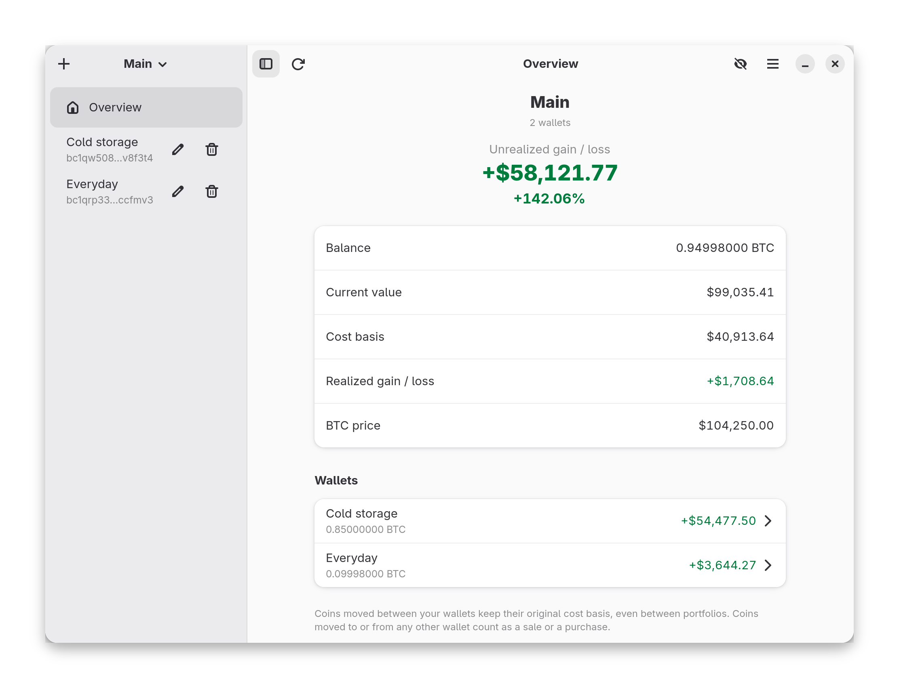

# Morlaco

[](https://github.com/jeronimoalbi/morlaco/actions/workflows/test.yml)
[](https://github.com/jeronimoalbi/morlaco/actions/workflows/audit.yml)
[](LICENSE)

Morlaco is a small GNOME app. It reads the public blockchain, looks up what
the coin cost on the days your coins arrived, and shows your estimated gain or
loss.

<p align="center">
  
</p>

## What you get

- Your balance and what it's worth in US dollars.
- Your gain or loss, for each wallet and for all of them together.
- Your coins, listed by the day they arrived and the price back then.
- A button that hides every number, for when someone is looking over your
  shoulder.
- Moves between your own wallets aren't treated as selling, so they don't mess
  up your numbers.
- Your saved data is encrypted on your computer.

## Install

It requires Rust 1.92 or newer, GTK 4, libadwaita 1.5 or newer, libsecret,
OpenSSL, a C compiler and pkgconf. libsecret is only needed on Linux.

**Arch Linux:**

```sh
cd contrib/arch/local && makepkg -si
```

That builds the latest committed version and installs it with pacman.
To remove it later: `sudo pacman -R morlaco-git`.

**From source**

On Arch first run:
```sh
sudo pacman -S base-devel rust gtk4 libadwaita libsecret openssl
```

Anywhere, once you have the dependencies:

```sh
cargo build --release
sudo install -Dm755 target/release/morlaco /usr/bin/morlaco
sudo install -Dm644 contrib/desktop/io.github.jeronimoalbi.Morlaco.desktop /usr/share/applications/io.github.jeronimoalbi.Morlaco.desktop
sudo install -Dm644 app/data/icons/hicolor/scalable/apps/io.github.jeronimoalbi.Morlaco.svg /usr/share/icons/hicolor/scalable/apps/io.github.jeronimoalbi.Morlaco.svg
sudo install -Dm644 app/data/icons/hicolor/symbolic/apps/io.github.jeronimoalbi.Morlaco-symbolic.svg /usr/share/icons/hicolor/symbolic/apps/io.github.jeronimoalbi.Morlaco-symbolic.svg
```

**macOS:** install the libraries with [Homebrew](https://brew.sh), then build:

```sh
brew install gtk4 libadwaita pkgconf openssl@3
OPENSSL_DIR="$(brew --prefix openssl@3)" cargo run --release
```

Your database key is kept in the Keychain, which may ask for permission the
first time. This is new and has only been built in CI so far.

Just want to try it? `cargo run` works from the checkout, no install needed.

## Handy keys

| Key | What it does |
| --- | --- |
| Ctrl+N | Add a wallet |
| Ctrl+R or F5 | Refresh |
| Ctrl+H | Hide or show amounts |
| F9 | Hide or show the sidebar |
| Ctrl+Q | Quit |

## Your data and privacy

- Everything Morlaco saves (your wallets, their history, prices) lives in one
  file, `~/.local/share/morlaco/morlaco.db`, and it's encrypted.
- You choose how the key is protected, in the main menu under **Encryption…**:
  - **Keyring** (the default): Morlaco makes a random key and keeps it in your
    system keyring (GNOME Keyring, or any other Secret Service). There's
    nothing to type. Someone who copies the file can't open it without your
    keyring.
  - **Keyring and passphrase**: a second lock. Morlaco asks for your
    passphrase every time it starts, and both are needed.
  - **Passphrase only**: no keyring at all. This works on computers without
    one, and the file can move to another computer. The catch is that your data
    is only as safe as your passphrase, because someone who gets the file can
    try guesses on their own machine. Use at least 12 characters.
- No keyring on your computer? Morlaco asks you to choose a passphrase the
  first time you start it.
- If you forget a passphrase, your saved data can't be recovered.
- **Recovery key:** if you use the keyring, **Recovery Key…** in the main menu
  shows the key Morlaco keeps there. Save it somewhere safe, like a password
  manager. If your keyring is ever reset, or you move to a new computer, choose
  **Use Recovery Key** from the ⋮ menu on the unlock screen to open your data again (add your
  passphrase too, if you set one). Anyone who has that key and your data file
  can open your data, so keep it private. With a passphrase only, there's no
  recovery key: the passphrase is the key.
- **Clear Local Data…** in the same menu deletes the file and the key.
- To read the blockchain and coin prices, Morlaco asks public websites. For
  Bitcoin that's [mempool.space](https://mempool.space). So that site sees
  which addresses you look up, along with the usual things any website sees,
  like your IP address.

## Development

```sh
just check                     # format, lints, tests and the dependency checks
cargo run                      # run the app from the checkout
cargo run --example screenshot # redraw docs/screenshots/overview.png (example data)
```

## License

MIT. See `LICENSE`.
